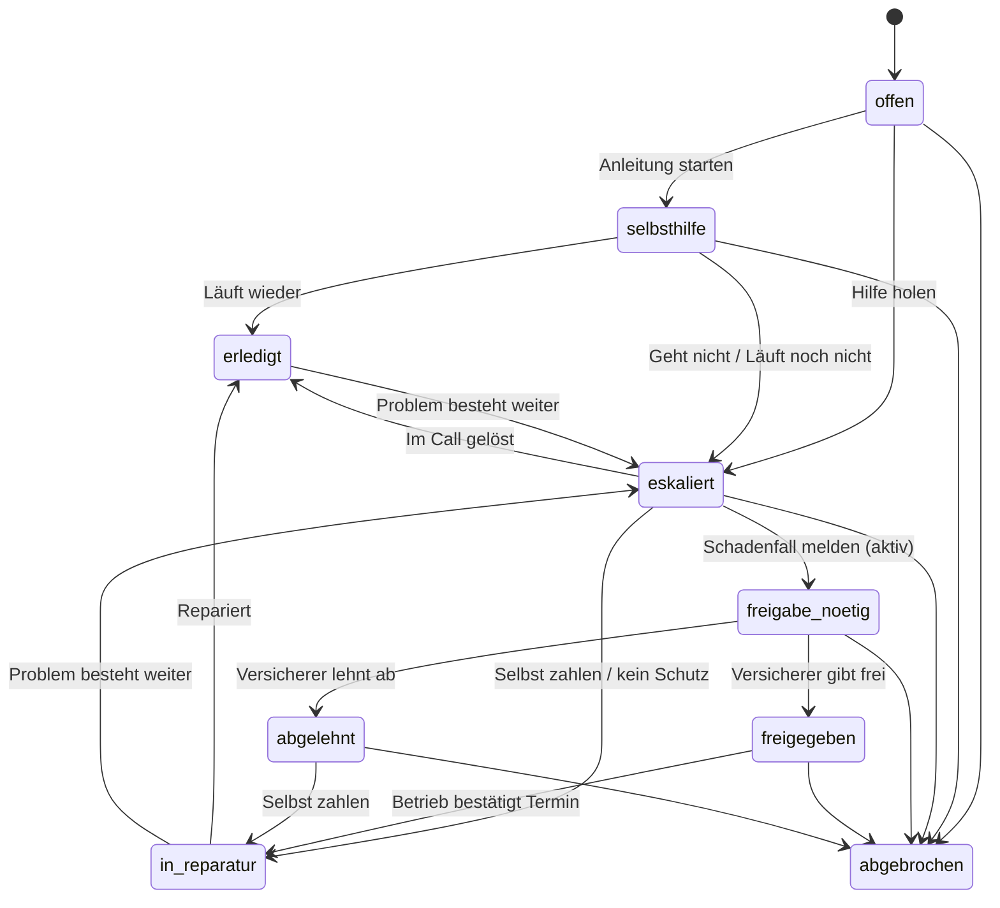

# Bauplan: Prototyp der Haushalts-App

Stand: 26.10.2026 · Phase 1 · wartet auf Freigabe · Grundlage: `docs/REVIEW.md`

## 1. Tech-Stack

Ich bestätige den Vorschlag aus dem Auftrag. Das Repo hat noch keinen Code, also gibt es keinen bestehenden Stack.

| Baustein | Wahl | Grund |
|---|---|---|
| App | **Expo (React Native), TypeScript strict, Expo Router** | Läuft im Pitch auf einem echten Handy über Expo Go. Echte Kamera und Haptik. Optional im Browser. |
| Navigation | Expo Router: Tabs, Fall als modaler Stack, Onboarding als eigene Gruppe | Zurück-Geste und Modals wie auf der Plattform üblich (B-50) |
| Zustand | Zustand mit `persist` auf AsyncStorage | Ein offener Fall übersteht den Neustart (B-03) |
| Backend | Kein Backend. Interfaces in `services/` mit Mock-Implementierung | Ein echtes Backend lässt sich später anschließen, ohne die Screens zu ändern |
| Kamera | `expo-camera` mit echtem Berechtigungs-Flow | B-15. Im Browser oder ohne Kamera: Demo-Fotos |
| Haptik | `expo-haptics` | Q-8 |
| Mitteilungen | `expo-notifications`, nur lokale Mitteilungen | Status und Pflege. Remote-Push braucht einen Development Build und ein Backend. Für den Prototyp reichen lokale Mitteilungen. |
| PDF | `expo-print` und `expo-sharing` (P2) | Fallakte teilen (Q-7) |
| Schrift | Schibsted Grotesk über `expo-font` (OFL-Lizenz) | Designsystem. Paket `@expo-google-fonts/schibsted-grotesk`, sonst TTF in `assets/fonts/` |
| Texte | `i18n/de.ts`, typisiertes Objekt, keine Bibliothek | Eine Datei, eine Sprache. Platzhalter als Funktionen. |
| Konfiguration | `config/demo.config.ts` | Whitelabel-Light: Versicherer, Händler, Hersteller, Betriebe, Preise, Demo-Schalter |
| Qualität | ESLint (`eslint-config-expo`), Prettier, Jest mit `jest-expo` | Auftrag 7.5. Eine Lint-Regel verbietet Hex-Werte außerhalb von `theme/`. |

Die Expo-SDK-Version lege ich beim Setup auf das aktuelle stabile SDK fest und schreibe sie ins README.

### Ordner

```
app/                      Expo Router
  (onboarding)/           willkommen, schutz, geraet
  (tabs)/                 index (Geräte), faelle, profil
  geraet/[id].tsx         Gerätedetail
  geraet/neu.tsx          Typenschild-Scan
  fall/                   modaler Stack, siehe Screen-Liste
components/ds/            Designsystem in React Native
components/               App-Komponenten
config/demo.config.ts
data/guides.ts            wörtlich aus guides() in Main.dc.html
i18n/de.ts
model/types.ts            Datenmodell (Abschnitt 3)
model/caseMachine.ts      Status-Maschine
services/                 Interfaces + mock/
store/                    Zustand-Stores mit persist
theme/                    Tokens Light und Dark, useTheme()
assets/photos/            Markenfotos (von Lennart)
docs/
```

---

## 2. Screens des Prototyps

Zustände: **L** Laden · **E** Leer · **F** Fehler · **O** Offline · **B** Berechtigung fehlt.

| Route | Screen | Zweck | Zustände | Komponenten |
|---|---|---|---|---|
| `(onboarding)/willkommen` | Willkommen | Was ganz macht, Datenschutzhinweis (Art. 13) | – | Wordmark, PhotoFrame, Button |
| `(onboarding)/schutz` | Schutz verknüpfen | Vertragsnummer oder Händler-Code eingeben. „Später“ möglich. | L, F (Nummer unbekannt), O | TextField, Button, InfoBox |
| `(onboarding)/geraet` | Gerät bestätigen | Gerät aus dem Vertrag bestätigen oder Typenschild scannen | L | DeviceCard, Button, NavRow |
| `(tabs)/index` | Geräte | Offener Fall, „Was ist kaputt?“, Geräteliste, Gerät hinzufügen | E (kein Gerät) | OpenCaseCard, SearchPill, DeviceCard, NavRow, TabBar |
| `(tabs)/faelle` | Fälle | Alle Fälle, offen oben | E | NavRow, StatusBadge |
| `(tabs)/profil` | Profil | Person, Schutz, Einwilligungen mit Widerruf, Datenschutz, Version (Demo-Geste) | – | NavRow, FactList, Checkbox |
| `geraet/[id]` | Gerätedetail | Status, Schutz, Pflege, Anleitungen, Fälle, Kundendienst, Kaufbeleg | E (kein Schutz) | PhotoFrame, FactList, NavRow, ActionBar |
| `geraet/neu` | Gerät hinzufügen | Typenschild fotografieren, Ergebnis prüfen und ändern, manuelle Eingabe | B, L, F (nicht erkannt) | CameraFrame, FactList, TextField, ActionBar |
| `fall/neu` | Problem melden | Foto, Meldung im Display, Symptom, „Etwas anderes“ | – | Card (inverse), NavRow, AppHeader |
| `fall/[id]/meldungen` | Meldung im Display | 8 Meldungen aus der Demo | – | NavRow |
| `fall/[id]/kamera` | Foto machen | Modus wählen, Auslöser | B, F (Kamera nicht verfügbar) | SegmentedControl, CameraFrame, ShutterButton |
| `fall/[id]/analyse` | Intelligente Fehlererkennung | Fortschritt in 4 Schritten, Abbrechen | L, F (unscharf, kein Gerät) | Checklist mit Ansage |
| `fall/[id]/rueckfrage` | Rückfrage | Bei „unsicher“: eine Frage mit 2 bis 4 Antworten | – | ChoiceChip |
| `fall/[id]/ergebnis` | Ergebnis | Fehlerbild, Sicherheit, „Bevor du anfängst“, Kostenhinweis ohne Zusage, „Passt nicht“ | – | FactList, InfoBox, ActionBar, Button (link) |
| `fall/[id]/anleitung` | Anleitung | Ein Schritt pro Ansicht. Zurück = Schritt zurück. „Geht nicht“, „Erledigt“. Abschlussfrage nach Typ. | O (läuft offline) | StepProgress, PhotoFrame, InfoBox (achtung), ActionBar, Sheet |
| `fall/[id]/hilfe` | Hilfe holen | Videocall (empfohlen), Vor-Ort-Diagnose, Kundendienst. Hinweis zur Weitergabe. | O | NavRow, InfoBox, FactList (Fallakte kurz), ActionBar |
| `fall/[id]/warteraum` | Verbindung | Wartezeit, Abbrechen, „keine Fachkraft frei“ → Rückruf | L, F | Card, Button |
| `fall/[id]/videocall` | Videocall | Fachkraft, eigenes Bild, Untertitel, Mikrofon, Kamera, Auflegen. Hinweis „keine Aufnahme“. | O (Abbruch) | VideoStage, RoundButton |
| `fall/[id]/befund` | Befund | Gelöst, Reparatur, Ersatzteil (nur Endnutzer-Teile) oder Ersatzgerät | – | SelectCard, ActionBar |
| `fall/[id]/kosten` | Kosten und Schadenmeldung | Reparatur gegen Ersatzgerät, Kostenträger, Selbstbeteiligung, was bei Ablehnung passiert, Fallakte-Vorschau, „Schadenfall melden“ | – | CostCompare, FactList, Disclosure, ActionBar |
| `fall/[id]/termin` | Betrieb und Termin | Betrieb wählen, Zeitfenster, Adresse, Zusammenfassung, „Termin anfragen“ oder „Zahlungspflichtig buchen“ | E (kein Betrieb frei) | SelectCard, ChoiceChip, FactList, ActionBar |
| `fall/[id]/status` | Fall-Status | Zeitstrahl: gemeldet, Freigabe, bestätigt, unterwegs, repariert | L, F (abgelehnt) | Timeline, Card, ActionBar |
| `fall/[id]/abschluss` | Abschluss | Abschlussfoto, „Läuft wieder“ oder „Problem besteht weiter“, Bewertung | – | PhotoFrame, StarRating, ActionBar |
| `fall/[id]/fallakte` | Fallakte | Alle Ereignisse, Fotos, Befund, Kosten. Teilen als PDF (P2). | E | Timeline, FactList, Button |
| Sheet | Schließen | „Später weitermachen“ oder „Fall abbrechen“ mit Grund | – | Sheet, ChoiceChip |
| Sheet | Geht nicht | Optional eine Notiz, dann „Hilfe holen“ | – | Sheet, TextField |
| Sheet | Demo-Steuerung | Szenario der Erkennung, Freigabe, Status weiter, Hinweise an/aus | – | Sheet, SegmentedControl |

---

## 3. Datenmodell

Die Typen gelten für App, Mock-Services und später für Backend und Dashboards. Datei im Build: `model/types.ts`. Ich habe sie mit `tsc --strict` geprüft.

```ts
// ganz – gemeinsames Datenmodell (App, später Backend und Dashboards)
// Zeitangaben: ISO 8601 mit Zeitzone. Beträge: Cent (ganzzahlig).

export type Id = string;
export type ISODateTime = string;
export type Cents = number;

// ---------- Haushalt, Personen, Vertrag ----------

export interface Address {
  street: string;
  zip: string;
  city: string;
}

export interface Person {
  id: Id;
  displayName: string;
  email?: string;
  /** Im Prototyp ist die Nutzerin immer Versicherungsnehmerin (Frage 2). */
  role: 'versicherungsnehmer' | 'mitglied';
}

export interface Household {
  id: Id;
  members: Person[];
  address?: Address;
  createdAt: ISODateTime;
}

export type PartnerKind = 'versicherer' | 'haendler' | 'hersteller' | 'betrieb';

export interface PartnerRef {
  id: Id;
  kind: PartnerKind;
  name: string;
}

export interface Contract {
  id: Id;
  householdId: Id;
  kind: 'garantieverlaengerung' | 'geraeteversicherung' | 'herstellergarantie';
  provider: PartnerRef; // Kostenträger, z. B. Versicherer
  soldBy?: PartnerRef; // Händler, über den der Schutz verkauft wurde
  productName: string; // „Garantieverlängerung“
  contractNumber: string;
  policyholderId: Id; // Person
  validFrom: ISODateTime;
  validUntil: ISODateTime;
  deductible: Cents; // Selbstbeteiligung
  coveredDeviceIds: Id[];
  linkedVia: 'vertragsnummer' | 'haendler_code';
  linkedAt: ISODateTime;
}

// ---------- Gerät ----------

export type DeviceCategory = 'waschmaschine' | 'geschirrspueler' | 'trockner' | 'kuehlschrank';

export interface Manufacturer {
  id: Id;
  name: string;
  serviceContact?: { label: string; phone: string; freeOfCharge: boolean };
}

export interface Device {
  id: Id;
  householdId: Id;
  manufacturerId: Id;
  category: DeviceCategory;
  model: string; // „WKB 130“
  materialNumber?: string; // vom Typenschild
  serialNumber?: string; // Fabrik-Nr. vom Typenschild
  purchaseDate?: ISODateTime;
  purchaseProofPhotoId?: Id;
  contractId?: Id;
  identifiedBy: 'typenschild_scan' | 'manuell' | 'vertrag';
  createdAt: ISODateTime;
}

// ---------- Fall und Status-Maschine ----------

export type CaseStatus =
  | 'offen'
  | 'selbsthilfe'
  | 'eskaliert'
  | 'freigabe_noetig'
  | 'freigegeben'
  | 'abgelehnt' // Ergänzung zum Auftrag: Ausgang der Prüfung sichtbar machen
  | 'in_reparatur'
  | 'erledigt'
  | 'abgebrochen';

export type CaseEntry = 'foto' | 'meldung' | 'symptom' | 'freitext' | 'pflege';

export type CaseResolution =
  | 'selbst_geloest'
  | 'im_call_geloest'
  | 'repariert'
  | 'ersatzteil_eingebaut'
  | 'ersatzgeraet'
  | 'pflege_erledigt';

export interface Claim {
  contractId: Id;
  reportedAt: ISODateTime;
  reportedBy: Id; // Person – nur durch aktive Bestätigung
  confirmationId: Id; // Consent mit purpose 'weitergabe_versicherer'
  decision?: {
    result: 'freigegeben' | 'abgelehnt' | 'rueckfrage';
    at: ISODateTime;
    actor: 'mensch' | 'regel'; // Art. 22 DSGVO
    approvedAmount?: Cents;
    note?: string;
  };
}

export interface Case {
  id: Id; // sichtbar, z. B. „GS-24817“
  householdId: Id;
  deviceId: Id;
  reportedBy: Id;
  status: CaseStatus;
  entry: CaseEntry;
  problemLabel: string; // „Wasserablauf“
  diagnosisIds: Id[];
  guideRunIds: Id[];
  photoIds: Id[];
  quoteId?: Id;
  bookingId?: Id;
  claim?: Claim;
  resolution?: CaseResolution;
  cancelReason?: string;
  pausedAt?: ISODateTime; // „später weitermachen“, kein eigener Status
  createdAt: ISODateTime;
  updatedAt: ISODateTime;
  closedAt?: ISODateTime;
}

// ---------- Ereignisse ----------

export type CaseEventType =
  | 'fall_angelegt'
  | 'foto_aufgenommen'
  | 'ergebnis_erkannt'
  | 'rueckfrage_beantwortet'
  | 'anleitung_gestartet'
  | 'schritt_erledigt'
  | 'schritt_zurueck'
  | 'schritt_geht_nicht'
  | 'sicherheit_bestaetigt'
  | 'anleitung_beendet'
  | 'weitergabe_bestaetigt'
  | 'einwilligung_widerrufen'
  | 'videocall_angefragt'
  | 'videocall_gestartet'
  | 'videocall_beendet'
  | 'befund_erstellt'
  | 'angebot_erstellt'
  | 'schaden_gemeldet'
  | 'freigabe_entschieden'
  | 'termin_angefragt'
  | 'termin_bestaetigt'
  | 'betrieb_unterwegs'
  | 'reparatur_abgeschlossen'
  | 'abschluss_bestaetigt'
  | 'problem_besteht_weiter'
  | 'bewertet'
  | 'pausiert'
  | 'fortgesetzt'
  | 'abgebrochen'
  | 'status_geaendert';

export type ActorKind = 'haushalt' | 'fachkraft' | 'betrieb' | 'versicherer' | 'system';

export interface CaseEvent {
  id: Id;
  caseId: Id;
  type: CaseEventType;
  at: ISODateTime;
  actor: { kind: ActorKind; id?: Id; name?: string };
  /** Typisiert pro Ereignis im Code (EventPayloads), hier offen gehalten. */
  payload: Record<string, unknown>;
}

// ---------- Foto und Ergebnis ----------

export type PhotoPurpose = 'display' | 'typenschild' | 'bauteil' | 'schritt' | 'kaufbeleg' | 'abschluss';

export interface Photo {
  id: Id;
  caseId?: Id;
  deviceId: Id;
  takenAt: ISODateTime;
  purpose: PhotoPurpose;
  source: 'in_app_camera' | 'betrieb' | 'demo'; // kein Galerie-Import
  uri: string;
  width?: number;
  height?: number;
  sha256?: string; // später: Integritätsnachweis
}

export type Confidence = 'hoch' | 'mittel' | 'unsicher';

export interface Diagnosis {
  id: Id;
  caseId: Id;
  photoIds: Id[];
  mode: 'display' | 'typenschild' | 'bauteil' | 'meldung' | 'symptom';
  errorPattern: string; // Fehlerbild, z. B. 'wasserablauf'
  displayMessage?: string; // gelesene Meldung
  component?: string; // „Laugenfilter“
  visibleDamage?: string;
  confidence: Confidence;
  confidenceScore: number; // 0..1, nur intern und für Dashboards
  source: 'fehlererkennung' | 'nutzerangabe' | 'fachkraft' | 'betrieb';
  guideId?: string;
  createdAt: ISODateTime;
}

// ---------- Anleitung ----------

export interface GuideStep {
  t: string; // Titel – wörtlich aus guides()
  d: string; // Text – wörtlich
  tool?: string;
  w?: string; // Warnhinweis – wörtlich
  img?: string; // Schlüssel des Fotos
}

export interface Guide {
  id: string; // 'ablauf', 'zulauf', …
  kind: 'stoerung' | 'pflege' | 'hinweis';
  title: string;
  code: string;
  noSelf?: boolean;
  sourceDocument: string; // „Gebrauchsanweisung WKB 130, M.-Nr. 10 162 440“
  steps: GuideStep[];
}

export interface GuideRun {
  id: Id;
  caseId: Id;
  guideId: string;
  startedAt: ISODateTime;
  currentStep: number;
  completedSteps: number[];
  abortedAtStep?: number; // „Geht nicht“
  abortNote?: string;
  outcome?: 'laeuft_wieder' | 'laeuft_nicht' | 'geht_nicht' | 'fertig';
  endedAt?: ISODateTime;
}

// ---------- Einwilligung und Bestätigung ----------

export type ConsentPurpose =
  | 'weitergabe_fachkraft'
  | 'weitergabe_versicherer'
  | 'weitergabe_betrieb'
  | 'screenshots_im_call'
  | 'hersteller_einzelfall'
  | 'mitteilungen';

export interface Consent {
  id: Id;
  personId: Id;
  caseId?: Id;
  purpose: ConsentPurpose;
  /** 'vertrag' = Bestätigung einer angefragten Leistung (lit. b), 'einwilligung' = lit. a */
  legalBasis: 'vertrag' | 'einwilligung';
  recipient: PartnerRef;
  dataCategories: string[]; // „Modell“, „Fotos“, „Protokoll“
  textVersion: string; // Version des gezeigten Hinweistexts
  grantedAt: ISODateTime;
  revokedAt?: ISODateTime;
}

// ---------- Kosten und Buchung ----------

export type Payer = { kind: 'versicherer' | 'haushalt' | 'haendler' | 'hersteller'; name: string };

export interface Quote {
  id: Id;
  caseId: Id;
  createdBy: { kind: 'fachkraft' | 'betrieb'; name: string };
  repair: { partName?: string; originalPart: boolean; parts: Cents; labor: Cents; total: Cents };
  replacement: { total: Cents; note: string };
  saving: Cents; // berechnet: replacement.total − repair.total
  payer: Payer;
  deductible: Cents;
  isExample: boolean; // Beispielwert aus der Demo-Konfiguration
  createdAt: ISODateTime;
}

export type BookingStatus = 'angefragt' | 'bestaetigt' | 'unterwegs' | 'erledigt' | 'storniert';

export interface Booking {
  id: Id;
  caseId: Id;
  kind: 'reparatur' | 'vor_ort_diagnose' | 'ersatzteil_versand';
  provider: PartnerRef & { authorized: boolean };
  slotLabel: string; // „Mo vormittags“
  slotStart?: ISODateTime;
  status: BookingStatus;
  subjectToApproval: boolean; // „vorbehaltlich Freigabe“
  address?: Address;
  completionPhotoId?: Id;
  rating?: { stars: 1 | 2 | 3 | 4 | 5; at: ISODateTime };
  createdAt: ISODateTime;
}

export interface VideoSession {
  id: Id;
  caseId: Id;
  expert: { name: string; provider: PartnerRef };
  requestedAt: ISODateTime;
  startedAt?: ISODateTime;
  endedAt?: ISODateTime;
  outcome?: 'verbunden' | 'keine_fachkraft' | 'abgebrochen';
  recording: false; // nie Tonaufnahme
  screenshotsConsentId?: Id;
}

// ---------- Status-Maschine ----------

export type CaseCommand =
  | 'anleitung_starten'
  | 'hilfe_holen'
  | 'selbst_geloest'
  | 'im_call_geloest'
  | 'schaden_melden'
  | 'freigabe_erteilt'
  | 'freigabe_abgelehnt'
  | 'termin_bestaetigt'
  | 'selbst_zahlen'
  | 'repariert'
  | 'problem_besteht_weiter'
  | 'abbrechen';

export const TRANSITIONS: Record<CaseStatus, Partial<Record<CaseCommand, CaseStatus>>> = {
  offen: { anleitung_starten: 'selbsthilfe', hilfe_holen: 'eskaliert', abbrechen: 'abgebrochen' },
  selbsthilfe: { selbst_geloest: 'erledigt', hilfe_holen: 'eskaliert', abbrechen: 'abgebrochen' },
  eskaliert: {
    im_call_geloest: 'erledigt',
    schaden_melden: 'freigabe_noetig',
    selbst_zahlen: 'in_reparatur',
    abbrechen: 'abgebrochen',
  },
  freigabe_noetig: { freigabe_erteilt: 'freigegeben', freigabe_abgelehnt: 'abgelehnt', abbrechen: 'abgebrochen' },
  freigegeben: { termin_bestaetigt: 'in_reparatur', abbrechen: 'abgebrochen' },
  abgelehnt: { selbst_zahlen: 'in_reparatur', abbrechen: 'abgebrochen' },
  in_reparatur: { repariert: 'erledigt', problem_besteht_weiter: 'eskaliert' },
  erledigt: { problem_besteht_weiter: 'eskaliert' },
  abgebrochen: {},
};

export function nextStatus(current: CaseStatus, command: CaseCommand): CaseStatus {
  const next = TRANSITIONS[current][command];
  if (!next) throw new Error(`Übergang nicht erlaubt: ${current} → ${command}`);
  return next;
}
```

### 3.1 Status-Maschine



Regeln, die Tests prüfen:

- Jeder Statuswechsel erzeugt ein `CaseEvent` vom Typ `status_geaendert`.
- `schaden_melden` geht nur mit einem `Consent` vom Zweck `weitergabe_versicherer`, den die Nutzerin selbst erteilt hat.
- Der Videocall startet nur mit einem `Consent` vom Zweck `weitergabe_fachkraft`.
- „Pausieren“ ist kein Status. Es setzt `pausedAt`.
- Die Ersparnis im `Quote` wird berechnet, nie eingetragen.

---

## 4. Komponenten

### 4.1 Aus dem Designsystem (nach React Native portiert)

Das Designsystem hat React-DOM-Komponenten (`.jsx`). Ich portiere sie nach React Native, mit gleichen Namen und Props, soweit möglich.

| Komponente | Quelle | Einsatz |
|---|---|---|
| Button (`primary`, `secondary`, `inverse`, `link`) | `core/Button` | Aktionsleiste, Leerzustände, Links |
| Wordmark | `core/Wordmark` | Startseite, Onboarding |
| TextField | `forms/TextField` | Vertragsnummer, Notiz, Freitext, manuelle Geräteangabe |
| Checkbox | `forms/Checkbox` | Optionale Einwilligungen |
| ChoiceChip | `forms/ChoiceChip` | Zeitfenster, Rückfrage, Abbruchgrund |
| SegmentedControl | `forms/SegmentedControl` | Kameramodus, Demo-Szenario |
| Card (`white`, `sunken`, `inverse`) | `content/Card` | Offener Fall, Foto-Einstieg, Kosten |
| FactList | `content/FactList` | Ergebnis, Fallakte, Zusammenfassung |
| Timeline | `content/Timeline` | Fall-Status, Fallakte |
| NavRow | `content/NavRow` | Listen mit Chevron |
| AppHeader | `app/AppHeader` | Kopfzeile mit rundem Zurück-Button (44 pt) |
| BottomBar → ActionBar | `app/AppHeader` | Feste Leiste: links Info, rechts Aktion |
| StepProgress | `app/StepProgress` | Anleitung |
| Toast | `app/Toast` | Kurze Bestätigungen, Demo-Tipps |
| StarRating | `app/StarRating` | Bewertung |

`ChatBubble` bleibt ungenutzt, weil der Chat gestrichen ist.

### 4.2 Neu, im Stil des Systems

| Komponente | Zweck |
|---|---|
| ThemeProvider, `useTheme()` | Tokens Light und Dark, folgt dem System |
| TabBar | 3 Tabs, Lucide-Icons und Text |
| Sheet | Schließen, Geht nicht, Demo-Steuerung |
| InfoBox (`info`, `achtung`) | „Achtung“ mit Dreieck und Wort, vor dem Schritttext (B-51) |
| PhotoFrame | Foto mit 12 px Radius. Ohne Foto: beschrifteter Platzhalter. |
| CameraFrame, ShutterButton | Kamera mit Rahmen, Auslöser mit Haptik |
| SelectCard | Auswahlkarte mit Radio-Semantik und Häkchen (B-30) |
| SearchPill, DeviceCard, OpenCaseCard | Startseite |
| ConfidenceLabel | Sicherheit als Wort, nie nur Farbe |
| CostCompare | Reparatur gegen Ersatzgerät, mit Kennzeichnung „Beispielwerte“ im Demo-Modus |
| Disclosure | Eingeklappte Fallakte-Vorschau |
| VideoStage, RoundButton | Videocall |

### 4.3 Theme

- Tokens aus dem Designsystem plus Dark-Werte aus dem Auftrag (Review, Abschnitt 8).
- Radien: Buttons 8, Fotos 12, Karten 14, Pillen 999.
- Typo-Rollen: `h1` 28/1.12/500, `title` 20–22/600, `body` 16–17/400, `meta` 13–14/400 muted. Alle skalieren mit der Systemschrift, Obergrenze Faktor 2.
- Rahmen für Bedienelemente: neues Token `border-control` mit mindestens 3 : 1 (B-44).

---

## 5. Reihenfolge der Umsetzung

Jeder Schritt endet mit einem Commit. Kein Push und kein PR ohne Anweisung.

| # | Schritt | Akzeptanzkriterien |
|---|---|---|
| 1 | **Setup**: Expo, TypeScript strict, Expo Router, ESLint, Prettier, Jest, README | `npm install`, `npx expo start` und `npm test` laufen. Lint ohne Fehler. README startet in 3 Befehlen. |
| 2 | **Theme und Basis-Komponenten** | Dark Mode schaltet mit dem System um. Lint-Regel findet keine Hex-Werte außerhalb von `theme/`. Eine Galerie im Demo-Modus zeigt alle Komponenten bei 100 % und 200 % Schrift ohne abgeschnittenen Text. |
| 3 | **Modell, Status-Maschine, Store, Konfiguration, Texte, Anleitungsdaten** | Tests decken jeden erlaubten und jeden verbotenen Übergang ab. Ein Skript vergleicht `data/guides.ts` mit `guides()` aus der Demo: alle Texte gleich. Der Store übersteht einen Neustart. Kein Text steht außerhalb von `i18n/de.ts`. |
| 4 | **Navigation**: Tabs, Fall-Modal, Onboarding | Jeder Screen hat einen Ausweg. Wischgeste und Android-Zurück verhalten sich gleich wie der Zurück-Button. |
| 5 | **Onboarding, Geräte, Gerätedetail, Gerät hinzufügen** | Vertragsnummer aus der Konfiguration verknüpft den Schutz. Falsche Nummer zeigt einen Fehler. Der Scan lässt sich korrigieren. Die Kundendienst-Nummer kommt aus den Gerätedaten. |
| 6 | **Problem melden, Meldungen, Symptome, „Etwas anderes“** | Kein Link verlässt die App. Taps bis zum ersten Schritt wie in Review 5.1. |
| 7 | **Kamera, Fehlererkennung, Rückfrage, Ergebnis** | Die drei Modi liefern verschiedene Ergebnisse. Szenario „unsicher“ zeigt die Rückfrage. Kamera abgelehnt: Hinweis und Link zu den Einstellungen. Jedes Foto hat Zeitstempel, Gerät und Zweck. Kein Text sagt Kosten zu. |
| 8 | **Anleitung** | App schließen in Schritt 4. Neu öffnen. Die Startseite zeigt den Fall. Ein Tap führt zu Schritt 4. Zurück geht einen Schritt zurück. „Geht nicht“ speichert den Abbruchschritt. Pflege-Anleitungen enden mit „Fertig“. Warnhinweise stehen vor dem Text. |
| 9 | **Hilfe holen, Warteraum, Videocall, Befund** | Ohne bestätigte Weitergabe startet kein Call (Test). Demo-Modus kann „keine Fachkraft frei“ auslösen. Der Call zeigt „keine Aufnahme“. Das Protokoll zeigt die echten Schritte, auch 0. |
| 10 | **Kosten und Schadenmeldung, Betrieb und Termin** | `freigabe_noetig` entsteht erst durch den Tap auf „Schadenfall melden“. Die Fallakte-Vorschau zeigt, was an den Versicherer geht. Bei Selbstbeteiligung > 0 € heißt der Button „Zahlungspflichtig buchen“. Die Pumpe geht nie an den Haushalt. |
| 11 | **Fall-Status, Mitteilungen, Abschluss** | Mock-Timer schaltet Freigabe, Bestätigung, unterwegs, repariert. Im Demo-Modus per Tap. Lokale Mitteilung bei jedem Wechsel, nach Zustimmung. „Problem besteht weiter“ öffnet den Fall wieder. |
| 12 | **Fälle, Fallakte, Profil** | Jeder Fall hat eine Fallakte aus `CaseEvent`. Einwilligungen lassen sich im Profil widerrufen. Der Widerruf erzeugt ein Ereignis. |
| 13 | **Demo-Modus und Whitelabel** | Ein Wechsel des Versicherers in der Konfiguration ändert alle Texte. Hinweise aus: keine Demo-Spur in der App. Geste im Profil öffnet die Demo-Steuerung. |
| 14 | **Barrierefreiheit und Qualität**, `docs/DATA_MODEL.md` | VoiceOver und TalkBack lesen jeden Bedienteil mit Label und Rolle. Alle Ziele mindestens 44 pt. 200 % Schrift ohne Verlust. DATA_MODEL.md sagt, welches Dashboard welche Felder liest. |
| 15 | **P2**: Fallakte als PDF, Pflege-Erinnerung, Kaufbeleg-Foto, Hinweis „Zuerst der Händler“ | Nur wenn 1 bis 14 fertig sind. |

### 5.1 Simulation (Mock-Services)

| Service | Verhalten im Mock |
|---|---|
| `DiagnosisService` | Regeln: Modus + Demo-Szenario → `Diagnosis`. Display: „Wasserablauf“, Sicherheit hoch. Bauteil: „Laugenpumpe blockiert“, mittel. Typenschild: Gerät erkannt, keine Diagnose. Szenario „unsicher“: Rückfrage zwischen Laugenfilter und Zulauf. Szenario „unscharf“: Fehler. |
| `VideoService` | Wartezeit 3 bis 8 s, dann verbunden. Szenario „keine Fachkraft“: Rückruf-Angebot. Befund aus dem Fall. |
| `ClaimService` | Freigabe nach 10 s oder per Tap. Szenario „abgelehnt“. Akteur `mensch`. |
| `BookingService` | Bestätigung, unterwegs, erledigt per Timer oder Tap. Abschlussfoto aus `assets/photos/`. |
| `NotificationService` | Lokale Mitteilung bei Statuswechsel. |

---

## 6. Bewusst weggelassen

- Login, Server-Konto und echte Verknüpfung mit Versicherer-Systemen
- Echtes Backend, echte Bilderkennung, echte Videotelefonie
- Remote-Push (braucht Development Build und Backend)
- Zahlung im Prototyp. Die Selbstbeteiligung wird nur angezeigt.
- Mehrere Personen im Haushalt (siehe Frage 2), mehrere Sprachen
- Chat und Platzhalter „Frage zu diesem Schritt“ (Review, Q-15)
- Import aus der Galerie (Nachweiswert der Fotos)
- Signatur oder Hash-Kette für Fotos (später mit Backend)
- Portale und Dashboards. Die App erzeugt nur die Daten.
- Analytics und Tracking
- Store-Builds für iOS und Android

## 7. Annahmen

- Schutz wird über eine Vertragsnummer oder einen Händler-Code aus der Konfiguration verknüpft.
- Die Nutzerin ist Versicherungsnehmerin (Frage 2).
- Golden Path: Fehlererkennung → Anleitung „Wasserablauf“ → „Geht nicht“ in Schritt 5 → Videocall → Befund „Laugenpumpe“ → Betrieb tauscht → Status → Abschluss.
- Termin „vorbehaltlich Freigabe“ (Frage 5).
- Selbstbeteiligung im Standard 0 €, umschaltbar (Frage 4).
- Bis die Markenfotos in `assets/photos/` liegen, nehme ich beschriftete Platzhalter. Die App-Fotos aus `design-system/assets/app/` nutze ich nicht automatisch, weil das Designsystem sie als KI-generierte Platzhalter kennzeichnet.
