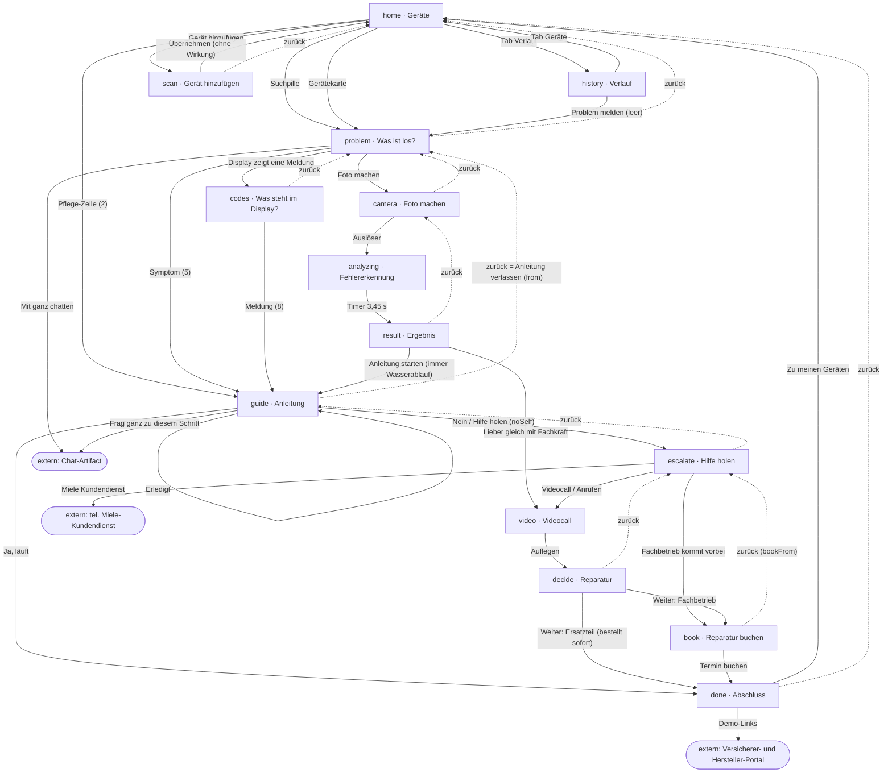
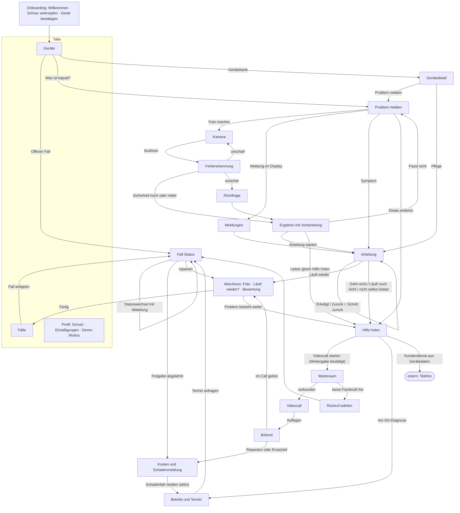

# Review: Haushalts-App, Klick-Demo v1.0

Stand: 26.10.2026 · Phase 1 · wartet auf Freigabe

## 0. Kurzfassung

- Die Demo erzählt den Golden Path gut. Der Look ist klar, die Anleitungstexte sind stark.
- **Fünf Punkte blockieren** einen Prototyp, den ein Versicherer prüft (P0):
  1. Der Schadenfall entsteht ohne Zustimmung. Die App sagt Kostenübernahme zu, bevor jemand freigibt.
  2. Die Fehlererkennung liefert immer dasselbe Ergebnis. Es gibt keinen Pfad für geringe Sicherheit.
  3. In der Anleitung geht der Fortschritt verloren. Wer nicht weiterkommt, muss „Erledigt“ tippen. Dann ist das Protokoll falsch.
  4. Ein „Weiter“ bestellt ein Ersatzteil. Es gibt keine Zusammenfassung und keine Adresse.
  5. Der Fall überlebt keinen Neustart der App.
- Rechtlich neu gefunden: Die **Laugenpumpe** gehört nach dem Ökodesign-Recht zu den Teilen für **fachlich kompetente Reparateure**. Endnutzer haben darauf keinen Anspruch. Der Pfad „Ersatzteil an den Haushalt, Einbau per Video“ passt dazu nicht (B-28).
- Der Soll-Flow spart Taps vor allem dort, wo es wehtut: Hilfe holen nach einem gescheiterten Schritt (12 → 7 bis 10). An zwei Stellen kommt **bewusst ein Tap dazu**: für die Bestätigung vor der Datenweitergabe und für die Schadenmeldung.

### Quellen und Annahmen

- Quelle für den Review ist die Canvas „ganz – Demo v1.0“ (Artifact, Stand 25.10.2026). Die Dateien liegen jetzt unter `reference/demo-v1.0/`.
- Das Designsystem stammt aus dem ZIP „Landingpage mit Umschalter gebaut“. Es liegt jetzt unter `design-system/`. Abweichungen zum Auftrag stehen in Abschnitt 8.
- Zeilenangaben wie `Main:726` beziehen sich auf `reference/demo-v1.0/Main.dc.html`.
- Die rechtlichen Punkte sind Arbeitshypothesen für das Produktdesign. Die Entscheidung liegt bei dir (siehe Frage 1).

---

## 1. Ist-Flow

14 Screens in `state.screen`, dazu 3 Ziele außerhalb der App. Durchgezogene Pfeile sind Aktionen. Gestrichelte Pfeile sind der Zurück-Button laut `backMap` (`Main:726`). `analyzing` und `video` haben keine Kopfzeile, also kein Zurück.

### Screen-Inventar

| Screen | Titel | Zurück zu | Auffällig |
|---|---|---|---|
| `home` | – | – | Zwei Einstiege führen zu `problem`. |
| `history` | Verlauf | – | Nur Sitzung, Datum fest „Heute“. |
| `scan` | Gerät hinzufügen | home | Kein Kamera-Flow, „Übernehmen“ ohne Wirkung. |
| `problem` | Problem melden | home | Chat-Link nach außen. |
| `codes` | Meldung im Display | problem | 8 Meldungen, gut. |
| `camera` | Foto machen | problem | 3 Modi, kein Berechtigungs-Flow. |
| `analyzing` | – | – | Kein Abbrechen, kein Fehlerfall. |
| `result` | Ergebnis | camera | Immer „Laugenfilter“. |
| `guide` | Titel der Anleitung | `from` | Zurück verlässt die Anleitung. |
| `escalate` | Hilfe holen | guide | „Schadenfall automatisch angelegt“. |
| `video` | – | – | Nur Auflegen. |
| `decide` | Reparatur | escalate | Ergebnis immer „Laugenpumpe“. |
| `book` | Reparatur buchen | `bookFrom` | Text setzt Videocall voraus. |
| `done` | – | home | Portal-Links. |

---

## 2. Befunde

Schwere: **P0** blockiert · **P1** wichtig · **P2** nice to have.

| ID | Screen | Befund | Kriterium | Schwere | Vorschlag |
|---|---|---|---|---|---|
| B-01 | home | Suchpille und Gerätekarte führen beide zu `problem`. Es gibt keine Gerätedetailseite. | Nielsen 4 Konsistenz, Flow | P1 | Gerätekarte öffnet die Gerätedetailseite. Die Suchpille startet „Problem melden“. |
| B-02 | home | Die Box „Garantieverlängerung“ ist nicht antippbar. Vertragsdaten sind nirgends einsehbar. | Nielsen 6 | P2 | Box öffnet Gerätedetail, Abschnitt „Schutz“. |
| B-03 | global | Der Zustand liegt nur im Speicher. Nach einem Neustart ist der Fall weg. Die Startseite zeigt keinen offenen Fall. | Zustände, Nielsen 1 | **P0** | Persistenz (Store). Karte „Offener Fall“ oben auf der Startseite. |
| B-04 | Fall-Screens | Man kann einen Fall nicht pausieren oder abbrechen. Es gibt nur Zurück. | Nielsen 3 | P1 | „Schließen“ (X) oben rechts. Sheet mit „Später weitermachen“ und „Fall abbrechen“ (mit Grund). |
| B-05 | guide | Zurück verlässt die Anleitung (`backMap.guide = from`). Ein neuer Einstieg setzt `step: 0` (`Main:628`). Es gibt kein „Schritt zurück“. | Nielsen 3, HIG Zurück-Geste | **P0** | Zurück = vorheriger Schritt. In Schritt 1 geht Zurück zum Einstieg. Der Fortschritt bleibt im `GuideRun`. |
| B-06 | guide | Vor dem letzten Schritt gibt es keinen Ausstieg. Wer nicht weiterkommt, muss „Erledigt“ tippen. Das Protokoll meldet dann falsche Schritte an Fachkraft und Versicherer. | Fehlervermeidung, Datenqualität | **P0** | Sekundäraktion „Geht nicht“ in jedem Schritt. Der Abbruchschritt geht ins Protokoll. |
| B-07 | guide | Am Ende steht „Nein“ ohne Kontext. Die Frage steht im Inhalt, die Antwort in der Leiste. | UX-Text, Nielsen 2 | P1 | Buttons „Läuft noch nicht“ und „Läuft wieder“. |
| B-08 | guide | Pflege-Anleitungen (Hygiene, Zulaufsiebe) und „Dosierung“ enden mit „Läuft die Maschine wieder?“. „Nein“ führt in die Eskalation mit „Schadenfall angelegt“. | Konsistenz, Recht | P1 | Anleitungstyp `stoerung`, `pflege` oder `hinweis`. Pflege endet mit „Fertig“ und einem Eintrag im Verlauf. |
| B-09 | guide | „Frag ganz zu diesem Schritt“ öffnet den verworfenen Chat außerhalb der App. | Scope | P1 | Entfernen. Alternative in 3.1 (Q-15). |
| B-10 | problem | „Mit ganz chatten“ öffnet den Chat außerhalb der App. | Scope, HIG | P1 | Entfernen. |
| B-11 | camera, analyzing, result | Das Ergebnis ist immer „Laugenfilter verstopft“, die Anleitung immer „Wasserablauf“. Im Modus „Typenschild“ steht „Meldung gelesen: Wasserablauf“. | Nielsen 2, Vertrauen | **P0** | Regel-Mock je Modus. Das Typenschild erkennt das Gerät und stellt keine Diagnose. |
| B-12 | result | Kein Pfad für geringe Sicherheit, „passt nicht“ oder „anderes Problem“. „Übereinstimmung: hoch“ ist fest. | Zustände | **P0** | Sicherheit in drei Stufen. Bei „gering“ eine Rückfrage. Link „Passt nicht“ zurück zu „Problem melden“. |
| B-13 | result | „Gedeckt über deine Garantieverlängerung … kostet dich das nichts extra“ steht vor jeder Prüfung. | Recht: Transparenz, Irreführung | P1 | „Brauchst du Hilfe, prüft Kranich die Kosten. Deine Selbstbeteiligung laut Vertrag: 0 €.“ |
| B-14 | analyzing | Kein Abbrechen. Kein Fehlerfall (unscharf, kein Gerät). Der Screenreader hört den Fortschritt nicht. | Zustände, A11y | P1 | Abbrechen. Fehlerzustand „Foto unscharf“. Ansage per `AccessibilityInfo.announceForAccessibility`. |
| B-15 | camera | Kein Berechtigungs-Flow, kein Zustand „Kamera abgelehnt“. | HIG und M3: Berechtigungen | P1 | Erklärung vor dem Systemdialog. Bei Ablehnung: Hinweis und Link zu den Einstellungen. |
| B-16 | camera | Fotos haben keinen Zeitstempel und keinen Gerätebezug. Das Versicherer-Portal behauptet aber „Fotos mit Zeitstempel, aufgenommen in der App“. | Recht: Nachweis, Pitch | P1 | `Photo` mit `takenAt`, `deviceId`, `purpose`, `source: 'in_app_camera'`. Kein Import aus der Galerie. |
| B-17 | escalate | „Ein Schadenfall wurde automatisch angelegt“, ohne Zustimmung (`Main:308`). | Recht: VVG §§ 30, 31; DSGVO Art. 6, 13 | **P0** | Die Schadenmeldung entsteht nur durch eine aktive Bestätigung auf dem Screen „Kosten und Meldung“. |
| B-18 | escalate | „Kranich übernimmt die Kosten. Selbstbeteiligung: 0 €“ steht vor jeder Freigabe. | Recht: Kostentransparenz | **P0** | „Die Kosten prüft Kranich nach dem Befund. Selbstbeteiligung laut Vertrag: 0 €.“ |
| B-19 | escalate | Der Videocall startet ohne Hinweis, wer welche Daten sieht. | DSGVO Art. 13 | **P0** | Hinweis zur Übermittlung und aktive Bestätigung vor dem Start (siehe 4). |
| B-20 | escalate | Den Videocall gibt es zweimal: als Zeile und in der Aktionsleiste. | Konsistenz | P2 | Eine Hauptaktion in der Leiste. Die Zeilen zeigen nur die Alternativen. |
| B-21 | escalate | Name und Nummer des Miele-Kundendiensts stehen fest im Code. Auch „aus der Miele-Anleitung“ und „Miele-autorisiert“. | Datenmodell | P1 | Aus `Device` und `Manufacturer.serviceContact`. |
| B-22 | escalate, video | Das Protokoll zeigt immer mindestens einen erledigten Schritt (`slice(0, idx + 1)`, `Main:813`), auch beim Weg direkt aus dem Ergebnis. Text: „1 Schritte“. | Datenqualität | P1 | Protokoll aus `CaseEvent`. Bei 0 Schritten: „Anleitung nicht gestartet“. |
| B-23 | video | Kein Verbindungsaufbau, keine Wartezeit, kein Fall „keine Fachkraft frei“. Die Dauer „04:12“ ist fest. | Zustände | P1 | Warteraum mit geschätzter Wartezeit. Ersatz: Rückruf oder Termin für den Videocall. |
| B-24 | video | Mikrofon und Kamera haben keine Funktion und keinen Zustand. | Nielsen 1, A11y | P1 | Umschalter mit `accessibilityState`. |
| B-25 | video | Kein Wort zur Aufzeichnung. | DSGVO Art. 6, 7; § 201 StGB bei Tonaufnahmen | P1 | Standard: keine Aufnahme, sichtbar im Call. Screenshots als Nachweis nur mit gesonderter Einwilligung. |
| B-26 | video → decide | Auflegen führt immer zu „Laugenpumpe defekt“. Es fehlen „im Call gelöst“ und „Ersatzgerät nötig“. | Flow | P1 | Screen „Befund“ mit Varianten aus dem Mock. |
| B-27 | decide | „Für dich fallen keine Kosten an, Kranich trägt alles“ steht vor der Freigabe. | Recht: Kostentransparenz | **P0** | Kostenträger „vorbehaltlich Freigabe“. Danach Status `freigabe_noetig`. |
| B-28 | decide, done | Weg „Ersatzteil schicken lassen“: Original-Laugenpumpe an den Haushalt, Einbau mit der Fachkraft per Video. Nach Ökodesign-Recht sind Pumpen Teile für **fachlich kompetente Reparateure**. Für Endnutzer gelten nur Tür, Scharnier, Dichtungen, Türverriegelung und Kunststoffteile. Die 15 Arbeitstage gelten für die bestellende Stelle. | Recht, Sicherheit | P1 | Pumpe: „Betrieb bestellt das Original-Teil und baut es ein“. Ersatzteil an den Haushalt nur bei Endnutzer-Teilen. Den Text zur EU-Pflicht präzisieren (siehe 4). |
| B-29 | decide | „Weiter“ löst die Ersatzteil-Bestellung aus. Es gibt keine Zusammenfassung und keine Lieferadresse. | Nielsen 5; § 312j Abs. 3 BGB, wenn Selbstbeteiligung > 0 € | **P0** | Zusammenfassung mit Adresse. Button „Ersatzteil bestellen“. Bei Selbstbeteiligung: „Zahlungspflichtig bestellen“. |
| B-30 | decide, book | Auswahlkarten nutzen `aria-pressed` statt Radio-Semantik. Die Auswahl zeigt sich nur über die Rahmenstärke. | A11y; WCAG 1.4.1 | P2 | `accessibilityRole="radio"`, Häkchen in der gewählten Karte. |
| B-31 | book (direkt) | Ohne Videocall sagt der Screen „Videocall-Befund“ und „bringt die Laugenpumpe gleich mit“. Das gilt auch nach „Türentriegelung“. | Datenqualität, Recht | P1 | Direktweg = „Vor-Ort-Diagnose“. Texte kommen aus dem Fall. |
| B-32 | book | „Termin buchen“ bestätigt sofort. Es fehlt die Bestätigung durch den Betrieb und die Freigabe. | Kostentransparenz | P1 | Button „Termin anfragen“. Danach Status-Ansicht. |
| B-33 | done | „Kranich hat die Kosten freigegeben“ erscheint sofort. Im Portal steht derselbe Fall auf „Freigabe nötig“. | Konsistenz, Pitch | P1 | Status kommt aus einer Quelle (`Case.status`). |
| B-34 | done | Portal-Links und „Demo: Derselbe Fall aus anderer Sicht“ stehen in der App. | Scope | P1 | Entfernen. Die Verbindung zu den Portalen gehört auf die Demo-Startseite. |
| B-35 | nach Buchung | Kein Status, keine Mitteilung, kein Abschlussfoto, keine Bewertung, kein „Problem besteht weiter“. | Nielsen 1 | P1 | Screen „Fall-Status“ und Screen „Abschluss“. |
| B-36 | history | Nur die Sitzung. Datum („Heute“) und Gerät stehen fest im Code. Keine Detailseite, kein Export. | Datenmodell | P1 | Tab „Fälle“ aus dem Store. Fallakte je Fall. Export als PDF (P2). |
| B-37 | history | Der Leerzustand verspricht „Als Nachweis für Betrieb, Hersteller oder Versicherung“, ohne Einwilligungsrahmen. | Recht: Transparenz | P2 | „Jeder Fall wird hier gespeichert. Du entscheidest, wer ihn sieht.“ |
| B-38 | scan | Die Erkennung lässt sich nicht korrigieren. „Übernehmen“ fügt nichts hinzu. | Nielsen 5 | P1 | Ergebnis bestätigen oder ändern. Manuelle Eingabe. |
| B-39 | global | Kein Onboarding, keine Verknüpfung mit dem Vertrag. | Flow, Pitch | P1 | Kurzes Onboarding mit 3 Screens (siehe 5). |
| B-40 | global | Kein Profil: Schutz, Einwilligungen, Datenschutz fehlen. | DSGVO Art. 7 Abs. 3, Art. 13 | P1 | Tab „Profil“. Widerruf so einfach wie die Einwilligung. |
| B-41 | global | Kein Hinweis auf die Reihenfolge der Kostenträger. Bei Geräten unter 2 Jahren kommt zuerst die Gewährleistung des Händlers. | Recht: § 437 BGB; Subsidiarität in vielen AVB | P2 | Kaufdatum prüfen. Unter 2 Jahren: Hinweis „Zuerst der Händler“. |
| B-42 | global | Zurück-Button 36 × 36 px, Segmente in der Kamera 36 px hoch. | WCAG 2.5.8; HIG 44 pt | P1 | Trefferfläche mindestens 44 × 44 pt (`hitSlop`). |
| B-43 | global | Schrift in festen px, Bilder 342 px breit, Telefon fest 844 px hoch. | WCAG 1.4.4; HIG Dynamic Type | P1 | Typo skaliert mit der Systemschrift. Layout flexibel. Test bei 200 %. |
| B-44 | global | Rahmen von Sekundär-Button und Eingabefeld (#BDBBB4 auf Weiß) haben 1,9 : 1. Der Ladering in der Analyse (#5C5F63 auf Ink) hat 2,8 : 1. | WCAG 1.4.11 (3 : 1) | P2 | Rahmen-Token für Bedienelemente mit mindestens 3 : 1, z. B. #8A8C8F (3,4 : 1). |
| B-45 | global | Placeholder #8A8C8F hat 3,4 : 1 auf Weiß. | WCAG 1.4.3 | P2 | Nur für Platzhalter in Feldern. Nie für Infotext. |
| B-46 | global | Begriffe wechseln: Meldung, Fehler, Problem, Defekt. Fachkraft, Betrieb, Werkstatt, Kundendienst. Fall, Schadenfall. Garantieverlängerung, Geräteschutz. | UX-Texte | P1 | Glossar (Abschnitt 6). |
| B-47 | global | Die Demo-Leiste (36 px) ist immer an. Die Hinweise stehen im Code. | Scope | P1 | Demo-Modus per Konfiguration (siehe 3, Punkt 13). |
| B-48 | decide, Portal | 189 € und 899 € stehen fest in App und Portal. 710 € (dieser Fall) und 538 € (Durchschnitt) sind verschiedene Größen ohne Beschriftung und ohne gemeinsame Quelle. | Konsistenz, Pitch | P1 | Werte in `demo.config.ts`. Die Ersparnis wird berechnet. |
| B-49 | home | Der Gerätestatus „läuft“ ändert sich bei einem offenen Fall nicht. | Nielsen 1 | P2 | Status aus `Case`: „Problem gemeldet“, „Reparatur am Mo“. |
| B-50 | global | Der Fall-Flow blendet die Tab-Leiste aus, ist aber kein Modal. Die Zurück-Logik hängt an `backMap`. | HIG, M3 | P1 | Fall als modaler Stack. Wischgeste = Schritt zurück. X = Schließen-Sheet. |
| B-51 | guide | Sicherheitshinweise (Verbrühung, Strom, Wasser) stehen in derselben grauen Box wie Kosteninfos. Bei „Waterproof“ gibt es keine Bestätigung „Wasserhahn ist zu“. | Sicherheit | P1 | Eigene Variante „Achtung“ mit Dreieck und Wort, vor dem Schritttext. Bei Waterproof: „Wasserhahn ist zu“ bestätigen. Inhalt unverändert. |
| B-52 | global | Die Demo nutzt viele Icons. Das Designsystem erlaubt nur 5 Zeichen und Lucide „mit Vermerk“. | DS-Konsistenz | P2 | Kleines Lucide-Set festlegen und im Designsystem vermerken. |
| B-53 | Pitch | Der Versicherer sieht in der App nicht, was bei ihm ankommt. | Pitch | P1 | Fallakte-Vorschau vor der Schadenmeldung, eingeklappt (siehe 7). |
| B-54 | problem | Die Symptomliste hat kein „Etwas anderes“. Ein unbekanntes Problem endet in einer Sackgasse. | Sackgasse | P1 | „Etwas anderes“: Freitext und Foto, dann „Hilfe holen“. |
| B-55 | global | Kein Offline-Zustand. | Zustände | P2 | Anleitungen lokal. Hinweis „Offline“. Videocall und Meldung gesperrt, mit Erklärung. |
| B-56 | home, book | Die App zeigt „M.-Nr. 10 162 440“ als Nummer des Geräts. Start- und Hersteller-Seite nennen dieselbe Nummer als M.-Nr. der **Gebrauchsanweisung**. Der Betrieb braucht aber die Nummern vom Typenschild. | Datenqualität | P2 | Im Datenmodell trennen: `Device.materialNumber` und `serialNumber` vom Typenschild, `Guide.sourceDocument` für die Anleitung. In der Demo die Nummer als Anleitungsquelle zeigen. |

---

## 3. Bewertung der bekannten Befunde (6.3)

| Nr. | Befund | Ergebnis | Präzisierung | IDs |
|---|---|---|---|---|
| 1 | Doppelte Einstiege | **Bestätigt** | Auch die Pflege-Zeilen umgehen den Gerätekontext. Die Garantie-Box führt nirgends hin. Gerätedetail: Status, Schutz, Pflege, Anleitungen, Fälle, Kundendienst. | B-01, B-02 |
| 2 | Fotodiagnose ohne Verzweigung | **Bestätigt, verschärft** | Im Modus „Typenschild“ meldet die Analyse eine Display-Meldung. Das Typenschild soll das Gerät erkennen, nicht den Fehler. | B-11, B-12 |
| 3 | Schadenfall ohne Zustimmung | **Bestätigt, verschärft** | Schon Ergebnis und Entscheidung sagen die Kostenübernahme zu. Auch ein „Nein“ nach einer Pflege-Anleitung führt zu diesem Text. Die Schadenanzeige ist eine Erklärung des Versicherungsnehmers (§ 30 VVG). Sie braucht seinen Willen. | B-08, B-13, B-17, B-18, B-27 |
| 4 | Anleitung verliert den Fortschritt | **Bestätigt** | Zurück springt zu `from`. Ein neuer Einstieg setzt `step: 0`. Der Zustand ist flüchtig. | B-05, B-06, B-03 |
| 5 | Unklare Abfrage | **Bestätigt** | Bei Pflege-Anleitungen ist die Frage selbst falsch. | B-07, B-08 |
| 6 | Zwei Wege zum Betrieb | **Teilweise bestätigt** | Der Direktweg ist sinnvoll: bei „nicht selbst lösbar“ (Waterproof, Türentriegelung) und für Menschen ohne Videocall. Das Problem ist der Inhalt: Die Buchung behauptet einen Videocall-Befund und eine Laugenpumpe. Vorschlag: Der Direktweg heißt „Vor-Ort-Diagnose“. Der Betrieb macht vor Ort einen Kostenvoranschlag. Danach folgen Freigabe und Reparatur. In der Fallakte steht dann der Befund des Betriebs. | B-31, B-32 |
| 7 | Kein Status nach der Buchung | **Bestätigt, verschärft** | Die App sagt „freigegeben“, das Portal „Freigabe nötig“. Im Pitch fällt das auf. | B-33, B-35 |
| 8 | Verlauf ist flüchtig | **Bestätigt** | Die Fallakte ist für den Versicherer der Kern. Sie gehört in den Prototyp. | B-36 |
| 9 | Kein Onboarding | **Bestätigt** | Im Prototyp nur ein lokales Profil, kein Login. Einstieg per Vertragsnummer oder Händler-Code. Berechtigungen nicht im Onboarding sammeln, sondern beim ersten Bedarf (HIG). | B-39 |
| 10 | Gerät hinzufügen | **Bestätigt** | „Übernehmen“ hat keine Wirkung. | B-38 |
| 11 | Kundendienst-Nummer fest | **Bestätigt** | Auch „Miele-Anleitung“ und „Miele-autorisiert“ sind fest. | B-21 |
| 12 | Videocall | **Bestätigt** | Dazu: Aufzeichnung (§ 201 StGB bei Ton). Die Fachkraft arbeitet für einen Betrieb. Dieser Betrieb ist Empfänger der Daten und muss im Hinweis stehen. | B-19, B-23 bis B-26 |
| 13 | Demo-Elemente | **Bestätigt** | Vorschlag Demo-Modus: `demo.enabled` in der Konfiguration. Versteckte Geste: im Profil 7-mal auf die Versionsnummer tippen. Hinweise als schließbare Tipps statt fester Leiste. Demo-Steuerung: Szenario der Erkennung wählen, Wartezeit überspringen, Freigabe auslösen, Status weiterschalten. | B-34, B-47 |
| 14 | Inkonsistente Zahlen | **Präzisiert** | Kein Widerspruch im engen Sinn. 710 € ist die Ersparnis dieses Falls (899 − 189). 538 € ist der Durchschnitt aller Fälle (680 − 142). Die App zeigt die 710 € gar nicht, nur das Portal. Das Problem: drei Stellen mit festen Werten und keine Beschriftung „dieser Fall“ oder „Ø 30 Tage“. | B-48 |
| 15 | Profil fehlt | **Bestätigt** | Tab „Profil“ mit Schutz, Einwilligungen, Datenschutz und Demo-Modus. | B-40 |

### 3.1 Bewertung der Quick Wins (6.4) und eigene

Nutzen und Aufwand: hoch, mittel oder gering.

| ID | Quick Win | Nutzen | Aufwand | Im Prototyp |
|---|---|---|---|---|
| Q-1 | Karte „Offener Fall“ | hoch | gering | **ja** (P0 mit B-03) |
| Q-2 | Werkzeugliste vor dem Start | hoch: Das Hersteller-Portal nennt genau diesen Punkt als Abbruchgrund | gering | **ja**, als Block „Bevor du anfängst“ im Ergebnis und in Schritt 1. Kein zusätzlicher Tap. |
| Q-3 | „Geht nicht“ → Eskalation mit Protokoll | hoch | gering | **ja** (P0 mit B-06) |
| Q-4 | Erkennungssicherheit und Rückfrage | hoch: Vertrauen und Pitch | mittel | **ja** (P0 mit B-12). Anzeige als Wort („hoch“, „mittel“, „unsicher“), nicht als Prozentzahl. |
| Q-5 | Kaufbeleg oder Garantie per Foto | mittel | mittel | **ja, light**: Foto speichern, keine Texterkennung. |
| Q-6 | Pflege-Erinnerungen als Push | mittel | gering (lokale Mitteilung) | **ja, P2**, erst nach Zustimmung |
| Q-7 | Diagnose-Protokoll als PDF teilen | hoch für den Pitch | gering bis mittel | **ja, P2** (zuletzt) |
| Q-8 | Haptik bei Auslöser und „Erledigt“ | gering bis mittel | sehr gering | **ja** |
| Q-9 | Fallakte-Vorschau vor der Schadenmeldung (eigene) | hoch: Versicherer und Transparenz | gering | **ja** |
| Q-10 | Hinweis „Zuerst der Händler“ bei Geräten unter 2 Jahren (eigene) | mittel: Händler-Pitch | gering | **ja**, nur Text |
| Q-11 | Pflege-Anleitungen ohne „Läuft wieder?“ (eigene) | hoch | gering | **ja** |
| Q-12 | Kundendienst aus den Gerätedaten (eigene) | mittel | gering | **ja** |
| Q-13 | Bestätigung bei Sicherheitsschritten, z. B. „Wasserhahn ist zu“ (eigene) | hoch | gering | **ja** |
| Q-14 | „Etwas anderes“ mit Freitext (eigene) | mittel | gering | **ja** |
| Q-15 | Platzhalter „Frage zu diesem Schritt“ (Option aus dem Auftrag) | gering | gering | **nein**. Ein Platzhalter ohne Funktion ist eine Sackgasse. Besser: Das Sheet „Geht nicht“ hat ein optionales Notizfeld. Die Notiz geht ins Protokoll und die Fachkraft sieht sie. |

---

## 4. Vertrauen und Recht

### 4.1 Datenflüsse

Arbeitshypothese. Sie trennt, was die Nutzerin anfragt (Art. 6 Abs. 1 lit. b DSGVO), von dem, was nur mit Einwilligung geht (lit. a). Grund: Eine Einwilligung für eine Leistung, die die Nutzerin selbst anfragt, ist widerrufbar und damit wackelig. Außerdem verlangt Art. 7 Abs. 4 DSGVO, dass sie nicht an die Leistung gekoppelt ist. In jedem Fall gilt: **Vor jeder Weitergabe steht eine aktive Bestätigung mit Empfänger und Datenumfang.**

| Datenfluss | Empfänger | Zeitpunkt | Rechtsgrundlage (Vorschlag) | Muster in der App |
|---|---|---|---|---|
| Fotos, Gerätedaten, Protokoll speichern | ganz | ab Fall-Start | lit. b (Nutzungsvertrag) | Datenschutzhinweis im Onboarding (Art. 13) |
| Protokoll und Fotos an die Fachkraft | Betrieb der Fachkraft | vor dem Videocall | lit. b | Hinweis „Jonas K. (Hausgeräte Brandt) sieht: …“, Button „Videocall starten“ |
| Screenshots im Call als Nachweis | ganz, Betrieb | im Call | lit. a, gesondert | Schalter, Standard aus. Keine Tonaufnahme. |
| Schadenmeldung und Fallakte | Versicherer | vor der Meldung | lit. b (Versicherungsvertrag); lit. a, wenn ganz eigene Daten ergänzt | Fallakte-Vorschau, Button „Schadenfall an Kranich melden“ |
| Auftrag mit Adresse und Termin | Betrieb | bei der Anfrage | lit. b | Zusammenfassung, Button „Termin anfragen“ |
| Fehlerbilder für Hersteller | Hersteller | laufend | Nur aggregiert, ohne Seriennummer und ohne Personenbezug. Einzelfall mit Personenbezug nur mit lit. a. | Profil: Schalter, Standard aus |
| Status-Mitteilungen | – | nach der ersten Anfrage | Systemberechtigung | Systemdialog erst nach „Termin anfragen“ |

Weitere Punkte:

- **Schadenfall (VVG):** Die App legt keinen Schadenfall an. Die Nutzerin meldet ihn aktiv. Vorher sieht sie Kostenträger, Selbstbeteiligung und was bei einer Ablehnung passiert („Dann entscheidest du: Reparatur selbst zahlen, Kostenvoranschlag behalten oder Fall schließen“). Offen ist, ob jede Person im Haushalt melden darf (Frage 2).
- **Button-Lösung (§ 312j Abs. 3 BGB):** Muss die Nutzerin etwas zahlen (Selbstbeteiligung > 0 €), heißt der Button „Zahlungspflichtig bestellen“ oder gleich klar. Der Prototyp steuert das über die Konfiguration.
- **Automatische Entscheidungen (Art. 22 DSGVO):** Das Portal zeigt eine „Automatische Prüfung“. Lehnt ein Versicherer automatisch ab, braucht es einen menschlichen Weg. Das Datenmodell speichert darum bei jeder Freigabe den Akteur (`mensch` oder `regel`).
- **Ersatzteile (Ökodesign):** Pumpen gehören zu den Teilen für fachlich kompetente Reparateure. Endnutzer bekommen Tür, Scharnier und Türdichtung, andere Dichtungen, Türverriegelung und Kunststoffteile wie den Einspülkasten. Die Lieferfrist von 15 Arbeitstagen gilt für beide Listen. Bei den Reparateur-Teilen gilt sie nur für registrierte Reparateure. Der Fakt „15 Arbeitstage“ bleibt in der App. Der Text sagt aber, für wen: „Der Betrieb bekommt die Original-Laugenpumpe innerhalb von 15 Arbeitstagen. So verlangt es das EU-Ökodesign-Recht.“ Geprüft habe ich das am Wortlaut der britischen Übernahme der Verordnung (EU) 2019/2023. Bitte gegen EUR-Lex gegenprüfen.
- **Fotos als Nachweis:** Aufnahme nur in der App. Jedes Foto speichert Zeitstempel, Gerät, Zweck und Fall. Kein Import aus der Galerie. Im Prototyp gibt es keine Signatur, das kommt später mit dem Backend.
- **Sicherheitshinweise:** Inhalt unverändert aus der Miele-Anleitung. Sie stehen vor dem Schritttext und sehen anders aus als Infoboxen (B-51).
- **Anleitungstexte:** Die Gebrauchsanweisung ist urheberrechtlich geschützt. Für den Pitch mit Miele passt das. Für den Betrieb braucht ganz eine Lizenz des Herstellers.

---

## 5. Soll-Flow

Grundsätze:

1. Drei Tabs: **Geräte**, **Fälle**, **Profil**.
2. Ein Fall läuft als **modaler Stack**. Zurück = Schritt zurück. X = Schließen-Sheet (später weitermachen oder abbrechen). Der Fortschritt bleibt erhalten.
3. **Keine Weitergabe ohne Bestätigung.** Keine Kostenzusage vor der Freigabe.
4. Jede Verzweigung hat einen Ausweg: „Passt nicht“, „Geht nicht“, „Etwas anderes“, „Keine Fachkraft frei“, „Problem besteht weiter“.

### 5.1 Taps bis zur ersten Hilfe

Gezählt ab der Startseite mit einem Gerät. Systemdialoge (Kamera-Berechtigung) zähle ich nicht. „Erste Hilfe“ heißt: der erste Schritt der Anleitung oder der verbundene Videocall.

| Einstieg | Ist | Soll | Grund |
|---|---|---|---|
| Foto → erster Schritt der Anleitung | 4 | 4 | Die Werkzeugliste steht im Ergebnis, kein eigener Screen. |
| Display-Meldung → erster Schritt | 3 | 3 | unverändert |
| Symptom → erster Schritt | 2 | 2 | „Bevor du anfängst“ steht in Schritt 1. |
| Foto → Videocall, ohne Anleitung | 4 | 5 | **+1**: Bestätigung der Weitergabe (B-19) |
| Foto → Videocall nach „geht nicht“ in Schritt 2 von 7 | 12 | 7 | Ausstieg in jedem Schritt (B-06) |
| Foto → Videocall nach „geht nicht“ in Schritt 5 von 7 | 12 | 10 | Ausstieg ohne falsches „Erledigt“ |
| Offenen Fall nach Neustart fortsetzen | nicht möglich | 1 | Persistenz und Karte „Offener Fall“ |
| Ende des Videocalls → Termin angefragt | 3 | 4 | **+1**: aktive Schadenmeldung (B-17) |
| Garantie oder Anleitung des Geräts ansehen | nicht möglich | 1 | Gerätedetail |

Rechnung für die Zeile „Schritt 5“: Ist = 3 bis zum Ergebnis + „Anleitung starten“ + 6 × „Erledigt“ bis Schritt 7 + „Nein“ + „Anrufen“ = 12. Soll = 4 + 4 × „Erledigt“ + „Geht nicht“ + „Videocall starten“ = 10.

---

## 6. Glossar für UX-Texte

| Begriff | Bedeutung | Nicht verwenden |
|---|---|---|
| Problem | Was der Haushalt bemerkt. Button: „Problem melden“. | Defekt, Störung (in Buttons) |
| Meldung | Text im Display des Geräts. „Meldung im Display“. | Fehlercode |
| Ergebnis | Was die Intelligente Fehlererkennung findet. Mit Sicherheit „hoch“, „mittel“ oder „unsicher“. | Diagnose (nur im Protokoll), KI, AI |
| Befund | Was die Fachkraft oder der Betrieb feststellt. | Ergebnis des Videocalls |
| Fall | Alles zu einem Problem, vom Melden bis zum Abschluss. | Vorgang, Ticket |
| Fallakte | Der Nachweis eines Falls (Fotos, Schritte, Befund, Kosten). Begriff aus dem Designsystem. | Diagnose-Protokoll |
| Schadenfall | Nur das, was an den Versicherer geht. Entsteht erst durch „Schadenfall melden“. | – |
| Fachkraft | Person im Videocall. | Techniker |
| Betrieb | Firma, die vor Ort repariert. Erstnennung „Fachbetrieb“. | Werkstatt, Partner |
| Kundendienst | Service des Herstellers. | Hotline |
| Schutz | Oberbegriff für den Vertrag. Im Text der Produktname aus der Konfiguration, z. B. „Garantieverlängerung bei Kranich“. | Versicherung (allein) |
| Kostenträger | Wer zahlt. In der App: „Das zahlt …“. | – |

Buttons sind immer Verb + Objekt oder ein klarer Zustand: „Anleitung starten“, „Erledigt“, „Geht nicht“, „Läuft wieder“, „Läuft noch nicht“, „Videocall starten“, „Schadenfall melden“, „Termin anfragen“.

---

## 7. Pitch-Wirkung

Frage: Erkennt ein Versicherer in 3 Minuten, dass bei ihm ein sauberer und prüfbarer Fall ankommt?

Heute nur über den Sprung ins Portal. In der App selbst sieht er es nicht. Vorschlag, ohne den Haushalt zu stören:

1. **Screen „Kosten und Schadenmeldung“:** Eine eingeklappte Zeile „Das geht an Kranich“. Aufgeklappt zeigt sie die Fallakte: 3 Fotos mit Uhrzeit, Ergebnis mit Sicherheit, erledigte Schritte mit Abbruchschritt, Befund, Reparatur gegen Ersatzgerät. Das ist genau die Ansicht aus dem Portal.
2. **Fall-Nummer** ab der Meldung sichtbar, z. B. „Fall GS-24817“. Dieselbe Nummer steht im Portal.
3. **Fall-Status** mit dem Schritt „Freigabe durch Kranich“. Im Demo-Modus kann man die Freigabe per Tap auslösen. So zeigt sich der Wechsel zwischen App und Portal live.
4. **Fallakte als PDF** (P2). Der Versicherer kann sie im Termin in der Hand halten.

---

## 8. Abweichungen zwischen Auftrag und Designsystem

Laut Auftrag gilt `design-system/`. Wo es Lücken hat, nehme ich den Auftrag.

| Thema | Auftrag | design-system | Annahme |
|---|---|---|---|
| Dark Mode | Tokens für Dark | nur Light | Dark-Tokens aus dem Auftrag ergänzen |
| Radius Karten | 12 px | 14 px (`--radius-lg`), Fotos 12 px | 14 px für Karten, 12 px für Fotos |
| Karten | Linien statt Kästen | weiß, ohne Rahmen | ohne Rahmen. Rahmen nur bei Auswahlkarten. |
| Seitenrand App | Demo: 24 px | 20 px | 20 px |
| Icons | Demo: viele | 5 Zeichen, sonst Lucide mit Vermerk | Lucide für Tab-Leiste und wenige Funktionen, Vermerk im README des Designsystems |
| Tab-Leiste, Sheet | gefordert | keine Komponente | neue Komponenten im Stil des Systems |

---

## 9. Offene Fragen

1. **Rechtsgrundlage je Datenfluss:** Gehst du mit der Trennung aus 4.1 mit (lit. b für angefragte Leistungen, lit. a nur für Optionales)? Oder willst du überall eine Einwilligung? Das ändert die Texte und die Profil-Seite, nicht den Flow.
2. **Wer meldet den Schaden?** Im Prototyp ist die Nutzerin auch Versicherungsnehmerin. Sollen andere Personen im Haushalt melden dürfen? Dann brauchen wir eine Rolle „mitversichert“ und eine Bestätigung durch den Versicherungsnehmer.
3. **Ersatzteil-Weg im Golden Path:** Mein Vorschlag: Die Pumpe bestellt und baut immer der Betrieb ein. „Ersatzteil an dich“ gibt es nur bei Endnutzer-Teilen und nicht im Golden Path. Einverstanden?
4. **Selbstbeteiligung im Pitch:** 0 € (wie in der Demo) oder ein Betrag wie 50 €? Bei einem Betrag gilt die Button-Lösung und der Pitch zeigt ehrlicher, was der Haushalt zahlt. Die Konfiguration kann beides.
5. **Termin vor oder nach der Freigabe?** Mein Vorschlag: Die Nutzerin fragt den Termin „vorbehaltlich Freigabe“ an. Das ist schneller und im Text klar. Alternative: Termin erst nach der Freigabe.
